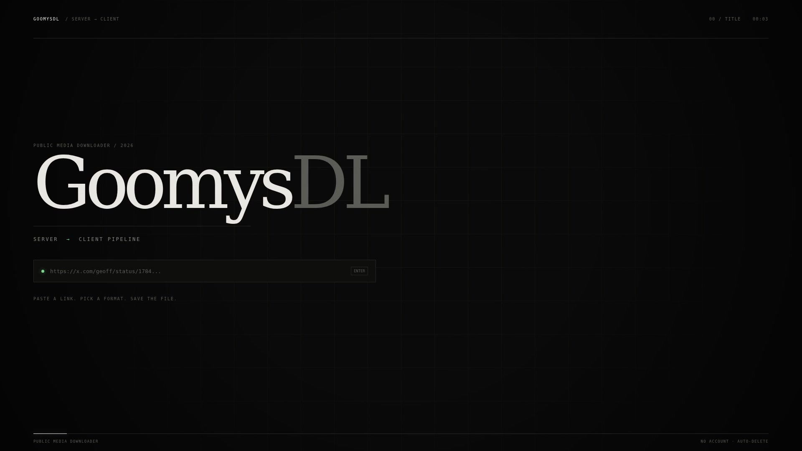

# GoomysDL

Web app for downloading video, photo, audio, and files from public sources. Built on Express, [yt-dlp](https://github.com/yt-dlp/yt-dlp), [gallery-dl](https://github.com/mikf/gallery-dl), [scrapr](https://github.com/coflyn/scrapr), and FFmpeg.

## Features

- Inspect a post and list available formats before downloading
- Queued jobs with live progress, 2 concurrent downloads
- Downloads sealed with AES-256-GCM at rest, keys held in memory only
- Files are stored under random names; original titles stay in memory only
- Files auto-delete after 10 minutes; analysis expires after 15 minutes
- Host allowlist (TikTok, Instagram, X/Twitter, YouTube, Facebook, Reddit, Vimeo, Twitch, SoundCloud, Dailymotion)
- Additional providers through `scrapr`: Spotify tracks, TeraBox, Threads, Pixiv, Douyin, MediaFire, Pixeldrain, Catbox, Google Drive, Krakenfiles, Doodstream, Komiku, Komikindo, Asura Scans, MangaDex, Nimegami, and Sfile
- Photo posts (Instagram carousels, TikTok slideshows) via `gallery-dl`
- Multi-file results (comic chapters, galleries, playlists) are bundled into one ZIP
- Supported page has a per-platform TEST button that checks extraction of a sample link (no download)
- Per-IP rate limit, 500 MB max file size, disk-space guard

## Demo

[](docs/demo-video.mp4)

70-second server → client walkthrough (MP4, no audio). Source animation: [docs/demo-video.html](docs/demo-video.html).

## Requirements

- Node.js 24+
- `yt-dlp` and `ffmpeg` on `PATH`
- `gallery-dl` on `PATH` for photo posts (`pip install gallery-dl`)
- `curl_cffi` in yt-dlp's Python environment for TikTok/Instagram impersonation (`pip install curl_cffi`)
- `zip` on `PATH` to bundle multi-file results into one archive
- `@coflyn/scrapr` is installed from npm; optional Playwright/Puppeteer deps are not needed

## Run locally

```bash
npm install --omit=optional
npm test
npm start
```

Open http://localhost:3000.

Environment variables:

| Variable | Default | Purpose |
| --- | --- | --- |
| `PORT` | `3000` | HTTP port |
| `YTDLP_PATH` | `yt-dlp` | Path to the yt-dlp binary |
| `FFMPEG_PATH` | `ffmpeg` | Path to the ffmpeg binary |
| `GALLERYDL_PATH` | `gallery-dl` | Path to the gallery-dl binary (photo posts) |
| `MAX_FILE_MB` | `500` | Max download size per job |
| `YTDLP_COOKIES` | (none) | Path to a Netscape `cookies.txt` for private/age-gated posts |

Existing yt-dlp/gallery-dl platforms are unchanged. The additional providers use scrapr and are best-effort: third-party endpoints can change or rate-limit requests. Spotify albums/playlists, comic series pages, anime batch pages, generic shortlinks, and ad-gateway unlockers are intentionally out of scope. For Nimegami, paste an episode download link, not the series page.

Instagram and TikTok use browser impersonation automatically. Public Instagram posts often work without a session, but private posts, stories and age-gated content need cookies from a logged-in account:

```bash
export YTDLP_COOKIES="$HOME/cookies.txt"
```

Export cookies from your browser in Netscape format. Cookies are session credentials: use a throwaway account, keep volume low, never commit the file (it is gitignored). Instagram photo posts also need the same cookies.

## Docker

```bash
echo 'DOMAIN=dl.example.com' > .env
docker compose up -d --build
```

Point the domain's DNS record to the VPS and open ports `80`/`443`. Caddy obtains HTTPS automatically. Set `MAX_FILE_MB` in `.env` if needed; for cookies, uncomment the volume/environment lines in `docker-compose.yml`.

The image runs as a non-root user. Do not mount a persistent volume over `downloads/`: the app wipes it on startup and the encryption keys only live in memory.

## Run on a phone (Termux)

```bash
./scripts/start.sh   # starts the server + a Cloudflare quick tunnel, prints the public URL
./scripts/stop.sh    # stops both
```

Logs are written to `~/.goomysdl/`. The quick-tunnel URL changes on every restart.

### Fixed URL with a named tunnel

1. Buy a domain and add it to your Cloudflare account (free plan).
2. Create the tunnel and DNS route:

   ```bash
   ./scripts/tunnel-setup.sh dl.example.com
   ```

   The first run opens a Cloudflare login link. After that, config is written to `~/.cloudflared/config.yml`.
3. Start as usual; `start.sh` prefers the named tunnel once the config exists:

   ```bash
   ./scripts/start.sh
   ```

The public URL then stays `https://dl.example.com` across restarts.

For auto-start on boot, install the **Termux:Boot** app and link the boot script:

```bash
mkdir -p ~/.termux/boot
ln -sf "$PWD/scripts/termux-boot.sh" ~/.termux/boot/goomysdl
```

Also disable Android battery optimization for Termux so the process is not killed.

## Notes

- Public items only. Private, age-gated, login-required, or region-locked content cannot be fetched.
- The allowlist intentionally blocks arbitrary URLs to prevent SSRF against internal networks. Media URLs returned by scrapers are revalidated before download; private and loopback addresses are rejected.
- Scraper providers receive the URL you paste. See the privacy page.
- Only download content you have the right to use, and respect each platform's terms of service.

## License

MIT — see [LICENSE](./LICENSE).
